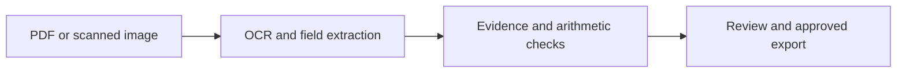
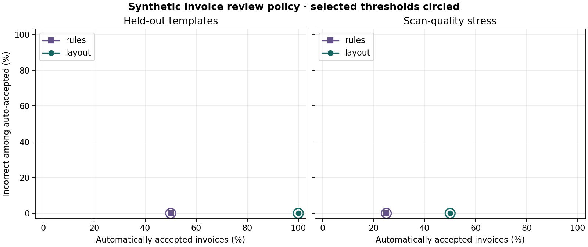

# Structured Invoice Extraction and Review

Portfolio by [Khush Bhavin Maru](https://github.com/Khushx11) · Adelaide University MAAIM.

How much invoice processing can run without human review at a chosen observed error target? This project compares two extraction approaches and links extracted values to a source page and region when evidence is available.

Upload an English PDF, PNG or JPEG, then inspect the extracted invoice beside its source. Review flags surface missing values and arithmetic discrepancies. Reviewers can correct fields, add or remove lines, approve records and export JSON or line-item CSV. The audit trail preserves the original extraction.


## Invoice review workflow





The chart shows fictional invoice cohorts from the full-record evaluation. Real FCC results cover amount extraction.

## Run locally

Install [Poppler and Tesseract](docs/deploy.md), then run:

```sh
python3 -m venv .venv
source .venv/bin/activate
python -m pip install -r requirements.txt
python -m invoice_review.server
```

Open [http://127.0.0.1:8000](http://127.0.0.1:8000). The upload accepts up to eight PDF pages and 15 MiB. Files and review state stay in the local data directory. The default workflow requires an approval action for every invoice.

## Try the fictional demo

[Watch the 69-second captioned browser recording](docs/demo.webm).

```sh
python -m tools.synthetic --output var/demo --demo
```

Upload `var/demo/clean-scan.png` and then `var/demo/ambiguous-scan.png`. Select **Locate Line 1 · Line amount** on the second invoice. Reconcile the displayed quantity and unit price, correct the amount to **84.96**, approve, and export both formats. See [the deployment guide](docs/deploy.md) for the macOS Vision adapter. With the recorded OCR revision, `python -m invoice_review.server --demo-policy` enables the synthetic-calibrated path only for exact copies of the locally generated fictional scans. OCR revisions or fixture bytes that differ from the demo requirements route to manual review.

## Benchmark and tests

```sh
python -m unittest discover -s tests -v
python -m tools.benchmark --output var/benchmark.json
python -m pip install matplotlib==3.10.6
python -m tools.plot_policy var/benchmark.json var/coverage-error.png
```

The spatial extractor auto-accepted **16 of 16** standard synthetic invoices and **4 of 8** degraded scans at the development-selected threshold. There were zero incorrect auto-accepts in those small cohorts. The rules baseline auto-accepted eight and two respectively. See [the measured results and plot](docs/evaluation.md) for matching definitions, p95, amount error and limitations.

GitHub Actions runs the scanned-invoice browser regression with Tesseract and validates the downloaded approved JSON against the versioned schema. For a local browser regression or recording, install Playwright and its Chromium build with `npm install --no-save playwright@1.62.1` and `npx playwright install chromium`. Start the matching macOS Vision demo server and run `node tools/demo.cjs`. Set `INVOICE_DEMO_VIDEO=var/demo.webm` to record the captioned flow.

## External datasets

An additional benchmark trains a text amount ranker on Hyperbots synthetic invoices and tests it on a held-out layout and real FCC invoices. It evaluates supplied OCR text and measures the limited transfer to FCC net amounts due. [External dataset provenance, commands and results](docs/external-data.md)

The upload flow also offers optional contrast and sharpness enhancement. Paired real-invoice tests found mixed enhancement results and no measurable exact-match gain from blur augmentation. [Blur experiment and reproducibility](docs/blur-robustness.md)

## Project documentation

- [Versioned schema and evidence coordinates](docs/schema.md)
- [Machine-readable approved record schema](schemas/invoice-v1.schema.json)
- [Dataset provenance and real-scan manifest format](docs/data.md)
- [Local deployment and limitations](docs/deploy.md)

The full-record extraction and automation-coverage benchmark uses fictional invoices. The real FCC and ConfBench experiments measure amount extraction only. The benchmark supports a permission-cleared real-scan manifest, and [the real-invoice study protocol](docs/data.md#real-invoice-study) specifies how to measure review effort. The extraction revisions are deterministic text rules and spatial heuristics over revision-recorded OCR. Complex tables, unlabelled fields, atypical currencies and heavily degraded scans can require substantial manual review.

## Licence

The original project code and documentation are available under the [MIT License](LICENSE). Third-party dependencies and external datasets retain their own terms. See [dataset provenance](docs/external-data.md) for the benchmark data licences.
