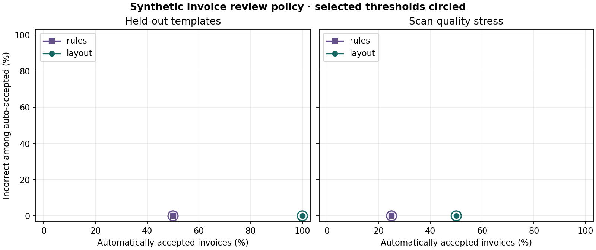

# Evaluation and human review

## Protocol

Both approaches receive identical page tokens. The rules extractor reads the last three numeric tokens in left-to-right order as quantity, price and amount. The spatial extractor assigns those tokens by the detected column locations and handles adjacent header labels. Both use the same label vocabulary, decimal normalisation and reconciliation. This isolates the incremental effect of spatial layout. The spatial extractor is deterministic and has no learned layout-model weights.

System settings were developed on three fictional supplier templates. Four additional templates used during debugging were excluded from the final report. The final test contains four unseen supplier templates with four invoices per template. The eight stress cases are newly generated documents using the same test templates and a separate degradation process. The two demo invoices are excluded. The published run used Apple Vision on macOS 27.2.1 and Poppler for embedded text and page images.

Each method independently chose the threshold with highest development automation coverage subject to at most 5% observed error among accepted documents. Ties choose the higher threshold. Both selected 1.0, which is an OCR score setting and has no probabilistic interpretation. Missing values, absent provenance, an absent table or a failed or unavailable reconciliation check override confidence and require review.

## Measured synthetic results

| Cohort and approach | Auto-accepted | Human review | Incorrect auto-accepted | Row precision | Row recall | p95 processing |
|---|---:|---:|---:|---:|---:|---:|
| Standard, text rules | 8 / 16 | 50% | 0 / 8 | 75.0% | 75.0% | 1.86 s |
| Standard, spatial | 16 / 16 | 0% | 0 / 16 | 100% | 100% | 1.86 s |
| Scan stress, text rules | 2 / 8 | 75% | 0 / 2 | 75.0% | 28.1% | 1.89 s |
| Scan stress, spatial | 4 / 8 | 50% | 0 / 4 | 100% | 37.5% | 1.89 s |

The threshold sweep largely overlaps within each method and cohort because several Apple Vision tokens and embedded PDF tokens have saturated confidence. Reject-all has zero coverage and undefined conditional error, so it is omitted from the plotted points. Arithmetic failures were zero across these cohorts. Both methods had unavailable arithmetic checks on four stress documents. The separately generated ambiguous demo intentionally contains an arithmetic discrepancy.

In the standard test, rules missed supplier, invoice number, date and currency on eight documents each. Spatial extraction had exact matches for all eight header fields. In the stress cohort, supplier, invoice number and tax were the most frequent spatial misses at four each. Standard-test unit price MAE was 2.67 AUD for rules over 56 paired rows and 0.00 AUD for spatial over 56 paired rows. Numeric errors condition on available paired values, so missing-value and recall metrics matter alongside them. All per-field measurements and denominators are in [synthetic.json](../results/synthetic.json).

Zero observed incorrect accepts on 16 documents does not establish a low error rate. Even under an independent-binomial assumption, the one-sided 95% upper bound is about 17.1%, and four shared template families make independence optimistic. There is no real-scan or human-review-time measurement. The stress review fraction is an estimate of workload on this synthetic cohort only.

## Definitions

- Header exact match applies the normaliser, treats null as an explicit value, compares invoice identifiers case-sensitively, case-folds other strings, and compares decimal values numerically.
- A line matches only when all four fields agree under normalisation. One-to-one multiset matching handles reordering and duplicate rows. For numeric MAE, lines are paired by normalised description in occurrence order, and only paired non-null amounts contribute.
- A fully correct invoice requires all header fields and all line-item rows to agree with truth.
- Reconciliation rates are invoice-level. Failed and unavailable are tracked separately. p95 is the nearest-rank percentile over PDF rendering, OCR and the measured method's extraction, excluding upload, fixture generation and the other extractor.

